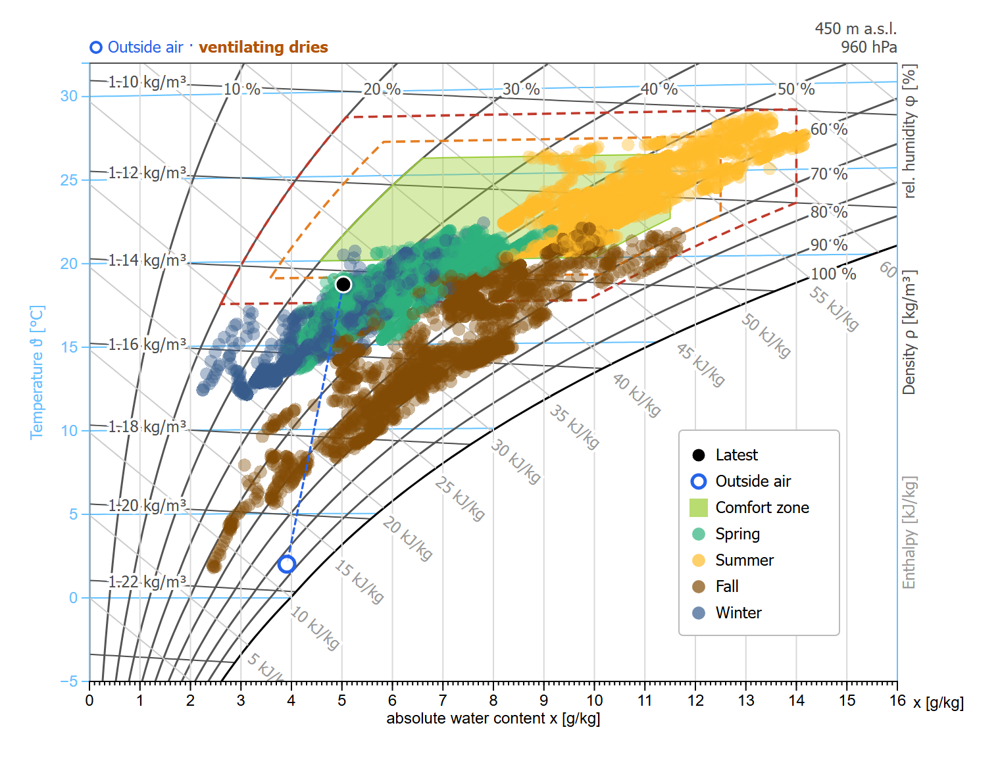
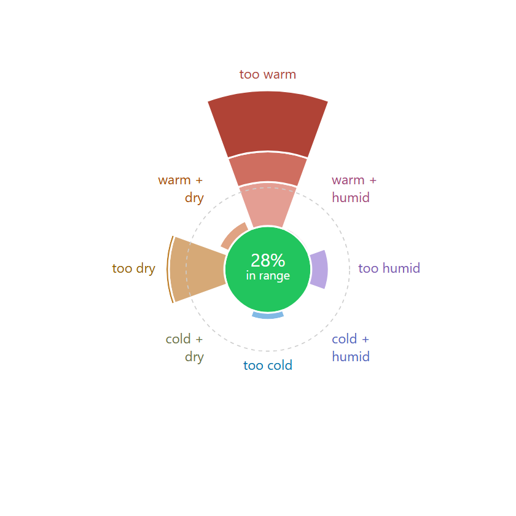

<p align="center">
  
</p>

<p align="center"><b><a href="https://retomarek.github.io/edap/intro.html">Read the book: retomarek.github.io/edap</a></b></p>

<p align="center">
  <a href="https://github.com/retomarek/edap/actions/workflows/deploy.yml"></a>
  <a href="https://jupyterbook.org/v1/"></a>
  <a href="https://pypi.org/project/pyedautils/"></a>
  <a href="https://github.com/retomarek/edap/commits/main"></a>
  <a href="LICENSE"></a>
</p>

<p align="center">An interactive online book for analyzing and visualizing energy and comfort time series data with Python.</p>

<p align="center">
  <a href="https://retomarek.github.io/edap/partDataVis/comfortMollierHx.html"></a>
  <a href="https://retomarek.github.io/edap/partDataVis/comfortCompass.html"></a>
</p>

> **Built on [pyedautils](https://github.com/retomarek/pyedautils)**, the *Python Energy Data Analysis Utilities*: a pip-installable library (`pip install pyedautils`) for analysing and visualising energy and comfort time series. Most recipes in this book call one of its functions, and its [documentation](https://retomarek.github.io/pyedautils/) has the full API reference and [guides on reading the h,x diagram and the comfort compass](https://retomarek.github.io/pyedautils/guides/).

## Why this book

Energy and comfort data from buildings are time series: smart meter readings, room sensors, weather stations. This book shows, one short recipe per page, how to load, check, prepare and plot them with pandas and Plotly, with real sample data and Jupyter notebooks that also open in Google Colab.

## Contents

- **Preface**
- **Part I: Getting Started**: Jupyter Notebooks, Python Packages
- **Part II: Python Basics**: Pandas Introduction, Loading Data, Datetime Handling, Data Wrangling, Time Series, Exploratory Data Analysis (EDA), Data Quality, InfluxDB (time series database), Meteo Data
- **Part III: Data Visualizations**
  - **Statistical Plots**: Boxplot, Density Plot, Density Plot by Season, Correlation & Scatter, Outlier Detection, Autocorrelation, Cross-Correlation
  - **Time Series Decomposition**: Long-Term, Short-Term
  - **Seasonal Visualizations**: Overlapping Years, Miniplots, Polar Chart, Before / After Comparison
  - **Heat Maps**: Calendar Heat Map, Median Weeks
  - **Daily Profiles**: Overview, Overlayed Profiles, Mean Profile, Decomposed Profile
  - **Sum & Frequency**: Daily Duration Curve, Hourly Duration Curve
  - **Comfort Diagrams**: Temperature & Humidity Over Time, Temperature vs. Humidity, [Mollier h-x Diagram](https://retomarek.github.io/edap/partDataVis/comfortMollierHx.html), Comfort Donuts, [Comfort Compass](https://retomarek.github.io/edap/partDataVis/comfortCompass.html), SIA 180 Adaptive Comfort
  - **Miscellaneous**: Energy Signature, Energy Signature (PES), Electricity Household, Multiple Y-Axes
- **Appendix**: Python Packages Overview, Resources, Python Installation & IDE Setup

The whole book is also available as a [PDF](https://retomarek.github.io/edap/edap.pdf).

## Local development

```bash
# Clone the repository
git clone https://github.com/retomarek/edap.git
cd edap

# Create a virtual environment (recommended)
python -m venv .venv
source .venv/bin/activate  # or .venv\Scripts\activate on Windows

# Install dependencies
pip install -r requirements.txt

# Build the book
jupyter-book build edap
```

After the build completes, open the book in your browser:

```bash
# macOS / Linux
open edap/_build/html/index.html

# Windows (Command Prompt)
start edap\_build\html\index.html

# Windows (PowerShell)
Invoke-Item edap\_build\html\index.html

# Or paste this path directly into your browser
# file:///path/to/edap/edap/_build/html/index.html
```

### Build scripts (Windows)

- **`build.bat`**: builds the book (fast, uses the cache). Then open `edap/_build/html/index.html` in the browser and refresh with F5.
- **`build-clean.bat`**: cleans the cache and rebuilds everything (use after config or logo changes, takes a few minutes).

### Rebuild after changes

Run `jupyter-book build edap` (or double-click `build.bat`) after making changes, then refresh the browser with F5. Jupyter Book caches executed notebooks, so only changed pages are rebuilt.

To force a clean rebuild (re-executes all notebooks):

```bash
jupyter-book clean edap
jupyter-book build edap
```

## Deployment

The book is automatically built and deployed to GitHub Pages via GitHub Actions on every push to `main` that changes `edap/`, `requirements.txt` or the workflow. The workflow executes all notebooks, builds the PDF and the HTML version and publishes them. See the [workflow](.github/workflows/deploy.yml) for details.

## Related projects

- [pyedautils](https://github.com/retomarek/pyedautils): Python Energy Data Analysis Utilities, with the h,x diagram (`plot_mollier_hx`), the comfort compass (`plot_comfort_compass`) and [guides on reading them](https://retomarek.github.io/pyedautils/guides/) (`pip install pyedautils`, [documentation](https://retomarek.github.io/pyedautils/)).
- [d3-mollierhx](https://github.com/hslu-ige-laes/d3-mollierhx): the interactive Mollier h,x diagram for the browser, built on D3.js ([live demo](https://hslu-ige-laes.github.io/d3-mollierhx/)).
- [Mollier hx Card](https://github.com/retomarek/mollier-hx-card): the h,x diagram as a Home Assistant dashboard card, with outside air and ventilation line.
- [Comfort Compass Card](https://github.com/retomarek/comfort-compass-card): the comfort compass as a Home Assistant dashboard card: how many days were too warm, too humid, too dry or too cold.

## Questions and feedback

- **Questions or ideas?** Ask in [Q&A](https://github.com/retomarek/edap/discussions/categories/q-a).
- **Found an error or want a topic covered?** Open an [issue](https://github.com/retomarek/edap/issues/new/choose).
- **Find it useful?** A star on GitHub helps others find it.

## Contributing

Corrections, new recipes and better explanations are welcome. See [CONTRIBUTING.md](CONTRIBUTING.md) for how to set up the book locally and open a pull request. Please note that this project is released with a [Contributor Code of Conduct](CONDUCT.md); by participating you agree to abide by its terms.

## Repository images

`docs/banner.png` (README header), `docs/social-preview.png` (GitHub social preview, 1280×640), the book's favicon (`edap/images/favicon.png`) and the example plots they use (`docs/images/branding_*.png`, also the images at the top of this README) are rendered with headless Chromium by `scripts/render_branding.py`, from the HTML templates `scripts/banner.html` and `scripts/social-preview.html`. They reuse the paper texture and the coffee cup of the book logo (`edap/images/logo_big.png`); the text is real text. Run from the repository root:

```bash
uv run --no-project --with playwright python -m playwright install chromium   # once
uv run --no-project --with playwright --with "pyedautils>=0.0.32" python scripts/render_branding.py
```

The social preview has to be uploaded manually under *Settings → General → Social preview* (there is no API for it).

## License

GPL-3.0 © Reto Marek, see [LICENSE](LICENSE).

## Credits

- Built with [Jupyter Book](https://jupyterbook.org/), [pandas](https://pandas.pydata.org/) and [Plotly](https://plotly.com/python/).
- Analysis and plot functions from [pyedautils](https://github.com/retomarek/pyedautils), Python Energy Data Analysis Utilities.
